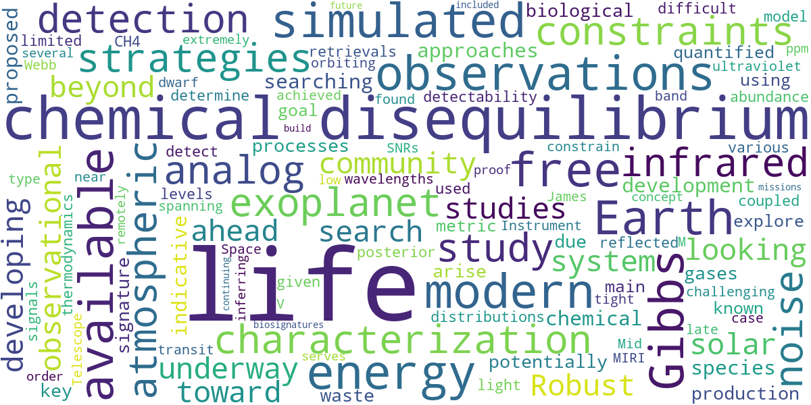

# Web Mining and Applied NLP Project Report

## Selected document and source URL

I chose [arXiv:2505.16231](https://arxiv.org/abs/2505.16231), *Modern Earth-like Chemical Disequilibrium Biosignatures Are Challenging To Constrain Through Spectroscopic Retrievals*, because it was coauthored by Dr. Gerrick Lindberg, my master’s thesis advisor at Northern Arizona University. I’m grateful for his guidance during my graduate research.

## Information selected for extraction

The pipeline extracts the paper’s arXiv ID, title, authors, subjects, submission date, abstract, journal DOI URL, and journal DOI. Transformation then pulls the paper metadata and abstract text into a structured record and writes the processed CSV.

## HTML structure and validation requirements

The pipeline extracts the arXiv abstract page HTML with `requests`, saves the raw document, and parses it with BeautifulSoup. Validation checks that the required elements are present before transformation: the title, authors, abstract, subject block, and dateline.

## Transformation and derived fields

The extracted paper metadata and abstract text are normalized into a structured CSV record. Derived fields reported for this paper include abstract word count (**250**), author count (**7**), and case-insensitive matches for the phrase "chemical disequilibrium" (**5**).

## Results

- Authors: **7**
- Abstract word count: **250**
- Case-insensitive matches for the phrase "chemical disequilibrium": **5**

## Interpretation and limitations

I expected the related DOI field on arXiv to point to the published journal version of the preprint. I confirmed that by following the extracted DOI URL from the page metadata, [https://doi.org/10.3847/1538-4357/addbd7](https://doi.org/10.3847/1538-4357/addbd7), which identifies the corresponding journal article. A missing DOI in this pipeline only means arXiv did not list one for that record; it does not prove that no journal publication exists elsewhere.

**Limitation:** The extraction depends on arXiv's current HTML structure and selectors, so layout changes or page variations could break field retrieval without code updates.

**Next step:** Extend the pipeline to process a small set of related papers and compare extracted metadata and phrase counts across them.

## Links

- [Source paper](https://arxiv.org/abs/2505.16231)
- [Repository](https://github.com/ajaneh/nlp-05-web-documents-academia)
- [Raw HTML](https://github.com/ajaneh/nlp-05-web-documents-academia/blob/main/data/raw/AH_GL_raw.html)
- [Processed CSV](https://github.com/ajaneh/nlp-05-web-documents-academia/blob/main/data/processed/AH_GL_processed.csv)
